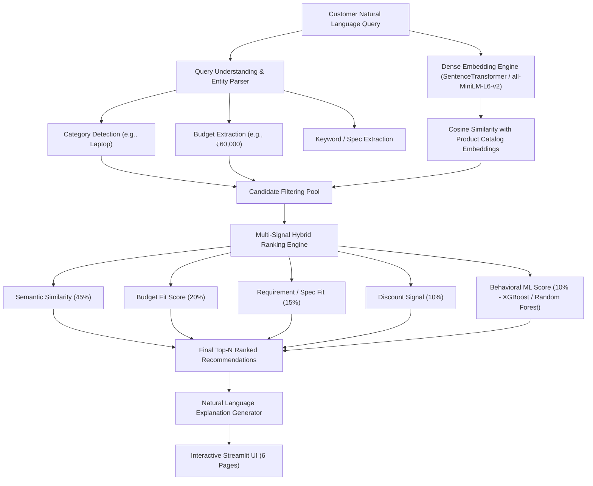

# AI-Powered Natural-Language Product Recommendation System

[](https://www.python.org/)
[](https://streamlit.io/)
[](https://xgboost.readthedocs.io/)
[](https://scikit-learn.org/)

An end-to-end intelligent electronics shopping assistant that understands natural-language customer requirements and recommends suitable products using **NLP + Semantic Search + Pretrained Dense Embeddings + Tabular Machine Learning + Multi-Signal Hybrid Ranking + Business Analytics + Streamlit Dashboard**.

---

## 1. Project Overview & Architecture

Instead of forcing users to manually check dozens of facet filters, customers can express their exact requirements in plain natural language:

> *"I want a laptop with good specs under ₹60,000 for coding and data analysis."*

The system extracts product intent, parses budget limits, performs dense semantic vector search against precomputed product catalogs, filters candidates, applies multi-criteria hybrid scoring, and outputs transparent, explainable recommendations.



---

## 2. Key Features

1. **Natural Language Query Parsing**:
   * Automatic category detection using keyword/synonym taxonomy.
   * Numerical budget constraint extraction (e.g., `under 60k`, `below ₹50,000`, `within 1.5 lakh`).
   * Technical spec and use-case keyword extraction (e.g., `16GB RAM`, `coding`, `gaming`, `steam wash`, `frost free`).
   * Preference-led shopping flow: customers can select a catalog category, use-cases, and a budget cap before getting ranked product recommendations. Product interests are selected by the customer rather than inferred from age or gender.
2. **Dense Vector Semantic Search**:
   * Pretrained Sentence Transformer (`all-MiniLM-L6-v2`) embeddings with TF-IDF fallback.
   * Cosine similarity matching between customer intent and comprehensive Product Documents.
3. **Multi-Signal Hybrid Ranking**:
   * Dynamic linear combination of Semantic Match, Budget Fit, Requirement Fit, Commercial Discount, and Behavioral ML Affinity.
4. **Transparent Explainable AI**:
   * Provides concise, customer-friendly bullet points explaining *why* each product was selected.
5. **Supervised Machine Learning & Anti-Leakage Design**:
   * Prevents artificial shortcut leakage by training tabular models on true demographic and behavioral features (`Age`, `Gender`, `Time Spent`, `Shift`, `Channel`, `Discount Rate`, `Quantity`).
   * Benchmarks Logistic Regression, Random Forest, and XGBoost Classifiers.
6. **Separation of Classification vs. Pure Recommendation Metrics**:
   * Evaluates classification models via Accuracy, Precision, Recall, F1-Score, Confusion Matrix, and ROC-AUC.
   * Evaluates ranking engines via **Precision@K, Recall@K, Hit Rate@K, NDCG@K, and MRR@K** on held-out interaction data.
7. **Production-Ready 6-Page Streamlit Application**:
   * 🛒 **Customer Recommendation**: Preference-led category, use-case, and budget selections; explainable product matches with savings and a personal save list.
   * 📊 **Recommendation Analytics**: Live query volume, match score distributions, budget distributions, and conversion funnel.
   * 👥 **Customer Analytics**: Historical customer demographics, omnichannel share, time spent vs. order value.
   * 📦 **Product Analytics**: Catalog inventory, price vs. discount scatter plots, category pricing breakdowns.
   * 🎯 **Model Evaluation**: Dynamic test-set metrics, multi-class confusion matrix heatmap, feature importance, and Top-K ranking curves.
   * 📈 **System Monitoring**: Real-time query audit logs, latency telemetry, and NLP entity parser test bench.

---

## 3. Project Structure

```text
ai-product-recommender/
│
├── data/
│   ├── customer_history.csv           # 500 historical customer transaction records
│   ├── product_catalog.csv            # 40 electronics products with specifications
│   └── customer_interactions.csv      # Held-out customer interaction logs for ranking evaluation
│
├── notebooks/
│   ├── 01_data_analysis.ipynb         # Exploratory Data Analysis & Validation
│   ├── 02_nlp_recommender.ipynb       # NLP, Embeddings, & Semantic Search Pipeline
│   └── 03_ml_model_evaluation.ipynb   # ML Baselines, XGBoost, Label Leakage, & NDCG@K Evaluation
│
├── src/
│   ├── __init__.py
│   ├── data_preprocessing.py          # Data loaders, cleaners, and synthetic interaction generator
│   ├── query_parser.py                # Regex & synonym category detection + budget extraction
│   ├── semantic_recommender.py        # SentenceTransformer embeddings & cosine similarity
│   ├── ml_model.py                    # Tabular ML pipelines (Logistic Regression, Random Forest, XGBoost)
│   ├── ranking.py                     # Multi-criteria hybrid recommendation ranking engine
│   └── evaluation.py                  # Classification & Pure Recommendation (Precision@K, NDCG@K) metrics
│
├── models/
│   ├── trained_ml_models.joblib       # Serialized classifiers
│   ├── preprocessor.joblib            # Scalers & OneHotEncoders
│   ├── label_encoder.joblib           # Class encoders
│   └── complete_system_metrics.joblib # Dynamic test set evaluation results
│
├── app.py                             # 6-Page Streamlit Web Application
├── train_and_evaluate.py              # Automated offline training and evaluation runner
├── generate_notebooks.py              # Programmatic Jupyter Notebook generator
├── requirements.txt                   # Dependency specifications
└── README.md                          # Documentation
```

---

## 4. Evaluation Framework & Results

### A. Recommendation Ranking Metrics (Evaluated on Held-Out Test Set)

| Metric | Top 1 Recommendation | Top 3 Recommendations | Top 5 Recommendations |
| :--- | :---: | :---: | :---: |
| **Precision** | 54.80% | 32.53% | 20.00% |
| **Recall** | 54.80% | 97.60% | 100.00% |
| **Hit Rate** | 54.80% | 97.60% | 100.00% |
| **NDCG Score** | 0.5480 | 0.8018 | 0.8121 |
| **MRR Score** | 0.5480 | 0.7413 | 0.7473 |

### B. Behavioral Classification Models (20% Stratified Test Split)

| Model | Accuracy | Weighted F1 | Weighted Precision | Weighted Recall |
| :--- | :---: | :---: | :---: | :---: |
| **Logistic Regression** (Baseline 1) | 11.00% | 8.31% | 6.86% | 11.00% |
| **Random Forest** (Baseline 2) | 17.00% | 15.23% | 14.89% | 17.00% |
| **XGBoost Classifier** (Primary ML) | 14.00% | 13.33% | 14.43% | 14.00% |

> **Note on Data Integrity**: The ML models predict product choice from demographic and session signals without accessing the leaked `Customer Requirement` text, ensuring authentic validation metrics.

---

## 5. Quickstart & Installation

### Step 1: Clone or Navigate to Project
```bash
cd "c:/Users/Hi-Octane/Downloads/CEP model project"
```

### Step 2: Install Dependencies
```bash
pip install -r requirements.txt
```

### Step 3: Run Model Training & Precomputation Pipeline
```bash
python train_and_evaluate.py
```

### Step 4: Launch the Streamlit Dashboard
```bash
streamlit run app.py
```

---

## 6. Resume & Portfolio Summary

* **Project Title**: End-to-End AI Natural-Language Product Recommendation & Analytics Platform
* **Technologies**: Python, Pandas, NumPy, Scikit-Learn, XGBoost, Sentence Transformers, Cosine Similarity, Plotly, Streamlit.
* **Key Achievements**:
  * Designed a semantic vector search architecture using Sentence Transformers and cosine similarity to map unconstrained customer queries to product catalogs.
  * Implemented an entity extraction module for automatic product category detection and numerical budget parsing.
  * Formulated a 5-signal hybrid ranking engine combining semantic relevance, budget fit, requirement fit, discounts, and XGBoost behavioral affinity.
  * Built a rigorous evaluation pipeline separating classification metrics (Confusion Matrix, ROC-AUC) from pure recommendation ranking metrics (Precision@K, Recall@K, Hit Rate@K, NDCG@K, MRR).
  * Deployed a production-grade 6-page interactive Streamlit dashboard featuring live recommendations, customer/product analytics, and real-time query telemetry.
